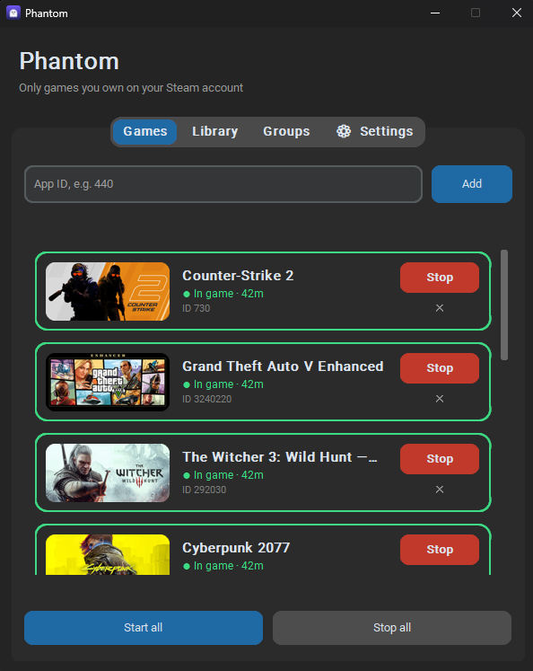

# Phantom 👻

Created by **LayEyzie**.

Tiny windows with game banners that report an "In-Game" status to Steam.
Works only for games you own on your account (checked with `BIsSubscribedApp`).

<!-- Add a screenshot here:  -->

## Usage
1. Download `Phantom.exe` from the Releases tab and run it anywhere - a single file, no installer.
2. On first launch it looks for `steam_api64.dll` in your installed Steam games, checks that it is
   signed by Valve and keeps its own copy in `%APPDATA%\Phantom`. Nothing to download or paste.
   If no suitable game is found, use **Settings → Steam API file → Choose file…**.
3. Start Steam and sign in, then add games by App ID or from the Library tab.

The DLL is never bundled or redistributed - it is copied locally from your own game folders
(Steamworks SDK license). Its SHA-256 is remembered; if the copy is ever modified, the app removes it
and restores a clean one automatically.

## Features
- **Games** - banner cards with status and uptime.
- **Library** - installed Steam games (all library folders) with banners and search; one click adds a game.
- **Groups** - bundle games and start/stop them together.
- **Tray icon** - menu: open, start all, stop all, quit.
- **Watchdog** - restarts games after a Steam restart or a crashed window.
- **Lightweight** - every game is a tiny separate process; switch off its window for the lowest memory use.
- **One instance** - launching the app again just brings the running window to the front.
- **Languages** - English, Polski, Deutsch, Español, Français, Português (Brasil), Русский, 简体中文.

## Settings (⚙ tab)
Grouped into sections:

**Startup**
- **Launch at system startup** - registers the app in the current user's startup entries (no admin rights).
  - **Start games automatically** - after startup, starts every game on your list (use Groups for subsets).
    If Steam isn't running yet it keeps retrying.
  - **Delay before starting games** - waits N seconds first (0 = no delay).

**Behavior**
- **Minimize to tray** - closing the window keeps the app in the tray; on system startup it starts hidden.
- **Show game windows** - turn off to run games with no windows at all (lowest memory use).
  Applies to games started afterwards; stop them from the app or the tray menu.
- **Auto-restart games** - if Steam is closed/restarted or a game window crashes, the game is started again
  once Steam is back. Closing a game window yourself stops it for good.
  Diagnostics: `%APPDATA%\Phantom\watchdog.log`.
- **Auto-stop timer** - stops each game after N hours.
- **Hide uninstalled games** - games not installed in Steam are hidden and skipped on launch.

**Steam** - the Steam API file (auto-detect or choose manually).

**General** - language (the app restarts and brings running games back) and the update check
(shows a banner when a newer GitHub release exists, never installs anything by itself).

**Data** - export/import games and groups as JSON, and a button that opens the data folder
(handy for bug reports - it contains `watchdog.log`).

Data lives in `%APPDATA%\Phantom` (`games.json`, `groups.json`, `settings.json`).
Data from earlier names of the app ("SteamPhantom", "SteamPresence") is migrated automatically.
On start the app also closes game windows left behind by an earlier run (crash, kill, older version).

## Verify your download
Each release contains `SHA256SUMS.txt`. Compare it with:

    certutil -hashfile Phantom.exe SHA256

PyInstaller executables are sometimes flagged by antivirus software (false positives). The code is open -
you can build it yourself with `build.bat`. Consider adding a [VirusTotal](https://www.virustotal.com)
scan link of each release here.

## Adding a language
Open `translations.py`, copy the `EN` block, translate the text after ` = `, add the code to `LANGUAGES`
and to `STRINGS`. Keep placeholders such as `{name}` unchanged.

## Building
Run `build.bat` locally, or use GitHub Actions: pushing a tag like `v1.3.0` builds the exe and attaches
it (plus checksums) to a release. Set `GITHUB_REPO` at the top of `phantom.py` to your
`owner/name` so the update check points at your repository.

## Development
No Windows or Steam is needed to run the tests - they use a fake toolkit:

    pip install pillow
    python tests/test_translations.py
    python tests/test_app.py

GitHub Actions runs them on every push (`.github/workflows/tests.yml`).

## License
MIT - see `LICENSE`.

## Disclaimer
Not affiliated with Valve. Artificially inflating playtime may violate Steam's terms. Use at your own risk.
